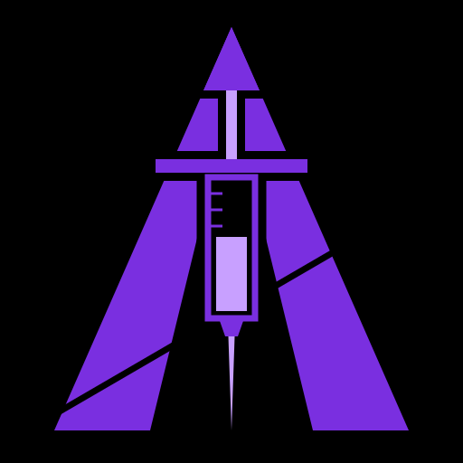

<p align="center"></p>

<h1 align="center">E X A R C H</h1>
<p align="center"><code>// DEFEND · ATTACK · AUTOMATE</code></p>

A personal Arch Linux distro for DevSecOps: niri with a violet desktop shell,
a free and open-source toolkit for containers, Kubernetes, IaC and supply-chain
security, the BlackArch repo for security tools, NVIDIA that works out of the
box, and a hardened default config. The ISO is built and signed in CI.

## What's inside

| Layer | What |
|---|---|
| Base | Arch Linux, built with `archiso` on top of Arch's official `releng` profile |
| Desktop | **niri** (scrollable tiling Wayland) + **Noctalia** shell, themed violet. Falls back to a themed waybar/fuzzel/mako setup if Noctalia isn't available |
| Fallback session | **KDE Plasma** (Wayland), pick it in the login screen with F3 |
| Apps | **LibreWolf** (Firefox kept as a fallback), **Obsidian**, **Discord**. All free of charge; Obsidian and Discord are closed source |
| Login | greetd + tuigreet (live ISO logs in automatically) |
| Shell | **bash** in kitty: ble.sh (fish-style suggestions + syntax highlighting), starship prompt, fzf (`Ctrl-R` history, `Ctrl-T` files, `Alt-C` dirs), zoxide (`z`), eza, bat, "command not found" package hints. Personal additions go in `~/.bashrc.local` |
| GPU | `nvidia-open` + `lib32-nvidia-utils` + `egl-wayland` + VA-API, auto-detected at boot; Mesa for Intel/AMD |
| Boot menu | Default · Safe graphics (nouveau + Plasma) · Rescue (text mode) |
| Repos | core, extra, multilib, **BlackArch**, plus a local repo of AUR packages built in CI |
| Hardening | sysctl hardening, ufw deny-incoming, AppArmor, btrfs snapshots, optional Secure Boot with your own keys |
| Stability | zram swap (zstd, compressed RAM), systemd-oomd kills a leaking app before the desktop freezes, weekly TRIM, package cache trimmed to the last 3 versions (rollbacks keep working), journal capped at 500 MB, `exarch update` / `exarch doctor` |
| Wallpapers | Animated wallpapers on niri, free out of the box: Exarch's own GPU shader wallpapers (violet nebula, synthwave grid, aurora, neon logo), plus any video (mpvpaper, pauses when hidden), GIFs and images with transitions (awww), the spinning logo, and optionally **Wallpaper Engine** scenes if you own it on Steam. Picked automatically at login, changed with `exarch wallpaper` |

### Toolkit tiers

| Tier | Where | What |
|---|---|---|
| Core (on the ISO) | `packs/core-tools.txt`, `packs/aur-core.txt` | podman, docker, kubectl, helm, k9s, kind, k3d, OpenTofu, Ansible, Trivy, Checkov, Syft, Grype, gitleaks, TruffleHog, Opengrep, cosign, OPA, conftest, kubescape, kube-bench, act, OpenBao, sops, nmap, nuclei, ffuf, sqlmap... |
| Optional packs | `packs/{cloud,web,network,offensive,runtime}.txt` | AWS/Azure CLIs, Prowler, Steampipe, ZAP, Wireshark, Metasploit, hashcat, Falco... |
| Non-free (opt-in) | `packs/nonfree.txt` | Terraform, Vault, Packer (BUSL-1.1), Burp Suite (proprietary) |

`config/tools.tsv` lists every tool by DevSecOps stage (Code → Build → Test →
Release → Deploy → Operate → Monitor, plus Recon/Attack).

Install an optional pack later:

```bash
exarch packs install cloud,web
exarch packs install nonfree --accept-nonfree
```

## The `exarch` command

One command for day-to-day Exarch. Run `exarch` with no arguments for the
welcome screen (it also opens once at first login, and from the bar's logo).

| Command | What it does |
|---|---|
| `exarch` / `exarch welcome` | Logo, quick status, keybinds, and a menu: `t` tools, `p` packs, `s` status, `d` driver |
| `exarch status` | Live or installed, kernel, session, NVIDIA driver (and whether a reboot is pending), Secure Boot, ufw, AppArmor, snapper, sysctl, tool and pack coverage |
| `exarch tools [STAGE]` | fzf browser for `config/tools.tsv`. Preview shows the package and man page. `Enter` opens the docs, or offers to install the missing tool's pack. `Ctrl-R` runs the tool. Filters: `-s TEXT`, `--missing`, `--installed`, `--plain` |
| `exarch packs` | Every pack with installed/total counts. `exarch packs show cloud` lists its packages |
| `exarch packs install cloud,web` | Installs packs through `exarch-setup` (asks for sudo) and refreshes the launcher entries |
| `exarch update` | Shows Arch news posted since your last upgrade (the "manual intervention" posts) and asks first, then `pacman -Syu` + AUR, then lists `.pacnew` files, failed services and whether to reboot |
| `exarch doctor` | One-screen health check: failed services, journal errors, RAM, zram, oomd, the 5 biggest memory users, disk space, days since update, pacnew, orphans, pending reboot, NVIDIA |
| `exarch clean` | Frees disk space safely: package cache down to the last 2 versions (rollback still works), unused dependencies (asks first), journal to 200 MB, AUR build cache, thumbnails |
| `exarch bootsplash on` / `off` | Exarch boot splash (Plymouth): the logo with a breathing violet glow, a progress line and a themed disk-unlock prompt. Adds the initramfs hook and `quiet splash` to systemd-boot/GRUB/UKI command lines (backups kept), and `off` puts everything back |
| `exarch driver` | NVIDIA packages and versions, the loaded module, pin state, and older versions in the pacman cache |
| `exarch driver pin` / `unpin` | Adds or removes an `IgnorePkg` line in `/etc/pacman.conf` for all NVIDIA packages (backup in `/etc/pacman.conf.exarch-bak`) |
| `exarch driver rollback [VER]` | Reinstalls an older driver from the pacman cache, all packages at the same version, then offers to pin it |
| `exarch splash` | The logo as 3D character art: lit, violet-to-pink, embers and a glow, block-letter title decoding in. Every new terminal shows it rotating slowly until you start typing (the key goes to your prompt). `--loop` is the screensaver version, plain `exarch splash` is a one-time spin-in, `--static` the final frame |
| `exarch wallpaper` | Picker with previews over everything you have: Exarch's shaders (and yours in `~/.config/exarch/shaders`), Wallpaper Engine workshop items (every Steam library), videos/GIFs/images in `~/Pictures/Wallpapers`, the spinning logo. `next` picks a random one, `set FILE\|WORKSHOP_ID`, `browse` opens the workshop in Steam, `static`, `help` |
| `exarch menu sync` | Adds app-launcher entries (`Super+D`) for every installed CLI tool, plus *Exarch Tools* and *Exarch Welcome* |

The terminal banner is set with `EXARCH_SPLASH` in `~/.bashrc.local`:
`spin` (default, rotates until you type), `intro` (one spin-in), `static`,
`fastfetch` or `off`. `ff` runs fastfetch with
the same art as a static logo (`branding/logo-art.txt`). To change the logo,
edit `branding/logo-mask.txt` (`.` empty, `1` body, `2` injector) or rebuild
it from the PNG with `scripts/make-logo-mask.py`, then regenerate the
fastfetch art with `exarch-splash --export-fastfetch --size 44 > branding/logo-art.txt`.

Bash tab completion is included (`exarch packs install cl<Tab>`). With `pacman -Syu`, a pinned driver shows up as
"ignoring package upgrade", which is expected.

## Repo layout

```
build.sh                  build the ISO (root, on Arch)
install.sh                turn an installed Arch system into Exarch
config/distro.env         name, ID, publisher  <- rename the distro here
config/packages.iso       ISO-only packages (NVIDIA, NetworkManager...)
config/tools.tsv          tool catalogue by DevSecOps stage
packs/*.txt               package packs (strict, best-effort, AUR, optional)
airootfs/                 files laid over the live system (also used by install.sh)
branding/                 logo, logo mask for the 3D splash, terminal art, wallpaper
scripts/                  AUR repo builder, BlackArch keyring, Docker build, package checker
airootfs/usr/local/bin/exarch   the exarch command (status, tools, packs, driver, update, doctor...)
rust/exarch-splash/       the 3D logo renderer (Rust, no dependencies)
.github/workflows/        lint + secret scan + build + sign pipeline
```

## Build the ISO

**GitHub Actions (easiest):** push this repo, then *Actions → build-iso → Run
workflow*, or `gh workflow run build-iso`. Download the `exarch-iso` artifact.

**Locally with Docker:** `./scripts/build-in-docker.sh`
(`SKIP_AUR=1` for a faster build without Noctalia/AUR tools)

**On Arch directly:** `sudo bash scripts/build-aur-repo.sh && sudo bash build.sh`

Package lists are checked before building: a wrong name in the strict lists
(`config/packages.iso`, `packs/desktop.txt`, `packs/base.txt`) fails the build;
everything else is skipped with a warning.

## Boot it

1. Flash the ISO with Rufus (GPT, DD mode) or Ventoy.
2. **Turn off Secure Boot** for the USB (the live ISO isn't signed).
3. Pick the USB in your boot menu (F8/F11/F12), UEFI mode.
4. **Exarch** boots into niri. If graphics fail, reboot and pick **safe graphics**.

niri basics: `Super+Enter` terminal · `Super+D` launcher · `Super+Q` close ·
`Super+O` overview · `Super+Shift+/` all shortcuts. The keyboard layout
defaults to German (`~/.config/niri/config.kdl` → `layout "de"`).

## Install

1. In the live system, run `archinstall`: **systemd-boot**, **btrfs**, your
   user, any profile (Exarch replaces the desktop setup).
2. Reboot into the new system, then:

```bash
git clone https://github.com/delusionaIs/exarch
sudo bash ./exarch/install.sh
```

This installs the packs, sets up NVIDIA (early KMS, suspend, VRAM fix for
niri), greetd, theming and hardening. Reboot and log in.

**Dual boot with Windows:** in archinstall, reuse the existing EFI partition
and install into free space you shrank from Windows beforehand. Don't let it
wipe the disk.

## Secure Boot

After installing (with systemd-boot):

1. BIOS → Secure Boot → *Reset to Setup Mode* / *Clear keys* (leave Secure Boot off)
2. `sudo exarch-setup --secure-boot`
3. BIOS → turn Secure Boot **on**. Check with `sbctl status`.

Microsoft's keys are kept, so Windows and your GPU firmware still boot. Have
your BitLocker recovery key ready.

## NVIDIA notes

- Arch ships NVIDIA's new-feature branch. If an update makes the cursor or
  desktop feel worse: `exarch driver rollback`, reboot, and keep it with
  `exarch driver pin` (rollback offers to pin for you). `exarch driver unpin`
  lets updates through again.
- If niri's cursor ever feels off, log out and pick **Plasma** with F3.
- Mouse acceleration is off in niri (`accel-profile "flat"`), like Windows
  with "Enhance pointer precision" disabled.

## Verify a CI build

```bash
sha256sum -c SHA256SUMS
cosign verify-blob SHA256SUMS --bundle SHA256SUMS.sigstore.json \
  --certificate-identity-regexp 'https://github.com/delusionaIs/exarch/' \
  --certificate-oidc-issuer https://token.actions.githubusercontent.com
```

## Security notes

- Set the repo variable `BLACKARCH_STRAP_SHA256` to the checksum from
  <https://blackarch.org/downloads.html> so CI refuses a tampered `strap.sh`.
- The AUR packages in `packs/aur-core.txt` are built from PKGBUILDs in CI.
  Keep that list short and review changes.
- Pin the GitHub Actions in the workflow to commit SHAs before relying on it.
- Being in the `docker` group is root-equivalent; prefer rootless `podman`.
- The offensive tools are for systems you own or are authorized to test.

## Shader wallpapers

`wallpapers/shaders/*.glsl` are original GLSL shaders (MIT, part of this
repo) that your GPU draws live through mpvpaper: mpv gets a tiny blank video
and runs the shader on its full-resolution output stage. They pause while
windows cover the desktop. `EXARCH_WALLPAPER_FPS=60` makes them smoother.
To write your own, copy one into `~/.config/exarch/shaders/` and edit
`scene()`: it gets the pixel position, the screen size and the time in seconds.

## Wallpaper Engine on Exarch (optional)

Wallpaper Engine itself isn't free (€4.99 on Steam). If you own it,
`exarch packs install aur-wallpaperengine` adds
[linux-wallpaperengine](https://github.com/Almamu/linux-wallpaperengine) plays
Wallpaper Engine's scene and video wallpapers natively (web ones are hit and
miss). It needs Wallpaper Engine **bought on Steam**, because it uses its assets:

1. Steam → Wallpaper Engine → Properties → Compatibility → force a Proton version
2. Install it. You never have to start it.
3. Subscribe to wallpapers in the workshop (`exarch wallpaper browse`)
4. `exarch wallpaper` → they're in the list, with previews

At login Exarch restores your last choice; the first time it picks a random
Wallpaper Engine wallpaper if you have any, then one of your videos, then one
of the shaders.
No Steam: put `.mp4`/`.webm` videos, GIFs or images in `~/Pictures/Wallpapers`.
Noctalia's own wallpaper is switched off the first time (backup:
`~/.config/noctalia/settings.json.pre-exarch`) so it doesn't cover yours.

## Why the renderer is Rust (and the rest isn't)

The splash and the live wallpaper redraw the logo 20-30 times a second for as
long as they run, so speed and a flat memory footprint matter there: in Rust
it takes about 1% of one CPU core and 3 MB of RAM (the Python fallback in
`airootfs/usr/local/lib/exarch/splash.py` needed about 25%). The other Exarch
tools are short shell scripts that run for a moment and exit, so they can't
leak memory, and rewriting them would add a compiler to every change without
making anything more stable. The OS's stability comes from Arch's packages
and the defaults above (zram, oomd, snapshots, a pinnable driver, `exarch update`).

## Ideas for v2

- `exarch lab`: one-command practice labs (vulnerable containers, a kind cluster)
- Signed live ISO (shim + MOK) so even the USB boots with Secure Boot on
- Graphical installer (Calamares), disk encryption by default
